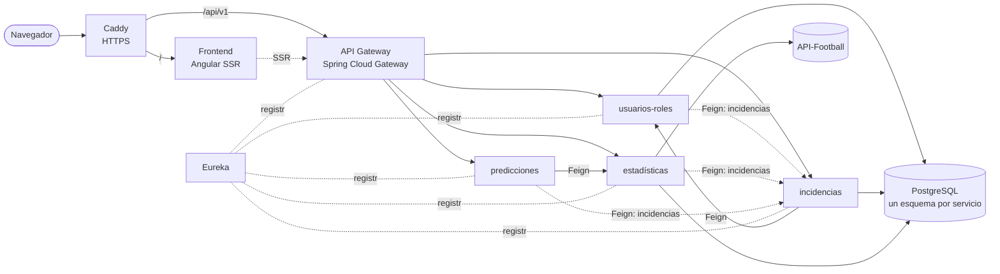

# ScoreVia

Plataforma de datos de fútbol: resultados en directo, estadísticas de equipos, jugadores, entrenadores y árbitros, y predicción de resultados con el modelo Dixon-Coles. Backend en microservicios con Spring Boot y Spring Cloud, frontend en Angular con SSR.


## Qué hace

- **Partidos**: marcador en directo, calendario y resultados, con eventos minuto a minuto (goles, tarjetas, cambios, VAR), alineaciones dibujadas sobre el campo, estadísticas de equipo y de jugador, bajas, cuotas y cara a cara histórico.
- **Predicciones**: probabilidades de victoria local, empate y victoria visitante antes del partido, recalculadas en directo según el marcador, el minuto y las expulsiones. Funcionalidad Premium.
- **Equipos y jugadores**: fichas con plantilla, trayectoria, traspasos, palmarés, dorsales por temporada y estadísticas acumuladas. Comparador entre equipos.
- **Competiciones**: clasificaciones por temporada de cientos de ligas y copas.
- **Usuarios**: registro con verificación por correo, login con Google, recuperación de contraseña, favoritos y reporte de usuarios.
- **Administración**: gestión de usuarios y roles, moderación de reportes, registro de incidencias técnicas y lanzamiento manual de sincronizaciones de datos.
- **Interfaz**: SSR, tema claro y oscuro, español e inglés.

Los datos vienen de [API-Football](https://www.api-football.com/) v3. La base de producción tiene unos 1,5 millones de partidos, 470.000 jugadores y 8,7 millones de eventos desde 2008. Este repositorio no incluye datos, solo el código y el esquema.

## Arquitectura



| Servicio | Puerto | Responsabilidad |
|---|---|---|
| `Gateway` | 8085 | Único punto de entrada. Enrutado por Eureka, circuit breakers, rate limiting por IP, CORS y Swagger agregado |
| `EurekaServer` | 8761 | Descubrimiento de servicios, protegido con Basic Auth |
| `Microservicio-usuarios-roles` | 8080 | Registro, login, JWT, Google OAuth, verificación de correo, roles y favoritos |
| `Microservicio-incidencias` | 8081 | Reportes entre usuarios y registro centralizado de errores de todos los servicios |
| `Microservicio-estadisticas` | 8082 | Ingesta desde API-Football y API de ligas, equipos, jugadores, partidos, entrenadores y árbitros |
| `Microservicio-predicciones` | 8086 | Motor Dixon-Coles pre-partido y en directo. Sin base de datos propia |
| `scorevia-frontend` | 4000 | Angular 21 con SSR |

## Decisiones técnicas

**Seguridad**
- Access token JWT de corta duración y refresh token en cookie `HttpOnly`. Login con Google mediante intercambio del ID token por un JWT propio.
- Verificación de correo con código de 6 dígitos y bloqueo temporal tras varios intentos fallidos de login, verificación o reseteo de contraseña.
- Comunicación interna con un secreto compartido: el Gateway sobrescribe la cabecera `X-Internal-Secret` que mande el cliente, y cada microservicio la valida en tiempo constante (`MessageDigest.isEqual`) antes del filtro JWT.
- Un rol de PostgreSQL por microservicio con permisos solo sobre su esquema, y protección contra mass assignment e IDOR en los endpoints de usuario.
- Rate limiting por IP en el Gateway, con un límite más estricto para los endpoints de autenticación.

**Ingesta de datos**
- Cliente de API-Football con rate limiting y reintentos de Resilience4j, y control de la cuota diaria.
- Trabajos programados para el directo, las estadísticas al acabar cada partido, el calendario, las clasificaciones y las plantillas de los clubes grandes. Cada uno se activa por variable de entorno.
- Deduplicación por clave natural de traspasos y trofeos, que en la API no tienen id propio, con índices únicos como garantía.
- Scripts de Python reanudables para el rellenado histórico, incluido el geocodificado del lugar de nacimiento de los jugadores con GeoNames.

**Predicciones**
- Modelo de Poisson con fuerza de ataque y defensa por equipo y ventaja de local, con la corrección de Dixon-Coles para los marcadores bajos.
- Modificadores por racha, cara a cara, bajas y árbitro. En directo aplica un decaimiento temporal y el impacto de las tarjetas rojas. El marcador se lee siempre del servidor, nunca del cliente.
- Circuit breaker en las llamadas Feign y caché en memoria con Caffeine.

**Infraestructura**
- Docker Compose con límites de memoria y de logs por contenedor, healthchecks y un overlay de producción con Caddy como proxy HTTPS.
- Pipeline de Jenkins: build, tests, análisis con SonarQube, quality gate y despliegue.
- AOP para logging y reporte automático de incidencias.

## Stack

| Capa | Tecnologías |
|---|---|
| Backend | Java 21, Spring Boot 4, Spring Cloud 2025.1 (Gateway, Eureka, OpenFeign, Circuit Breaker), Spring Security, Spring Data JPA, MapStruct, Resilience4j, Caffeine, springdoc-openapi |
| Frontend | Angular 21 (standalone + signals), SSR, Tailwind CSS, Transloco |
| Datos | PostgreSQL 15 |
| Tests | JUnit 5 y Mockito, Vitest |
| DevOps | Docker Compose, Jenkins, SonarQube, Caddy, GitHub Actions |
| Scripts | Python (requests, psycopg2, geopy) |

## Estructura

```
.
├── scorevia-backend/
│   ├── EurekaServer/
│   ├── Gateway/
│   ├── Microservicio-usuarios-roles/
│   ├── Microservicio-incidencias/
│   ├── Microservicio-estadisticas/
│   ├── Microservicio-predicciones/
│   ├── postgres-init/init.sql      # esquemas, tablas, índices y roles
│   ├── docker-compose.yml          # entorno local
│   ├── docker-compose.prod.yml     # overlay de producción (Caddy, HTTPS)
│   ├── docker-compose.infra.yml    # Jenkins y SonarQube
│   ├── Caddyfile
│   └── Jenkinsfile
├── scorevia-frontend/              # Angular
└── scripts/                        # rellenado histórico y utilidades en Python
```

## Cómo levantarlo

Requisitos: Docker con Compose y una API key de API-Football.

1. Copia `scorevia-backend/.env.example` a `scorevia-backend/.env` y rellena los valores.
2. Pon en `postgres-init/init.sql` las mismas contraseñas de los roles por microservicio que en el `.env`, o cámbialas después con `ALTER ROLE`.
3. Crea la red y el volumen que usa el compose:

   ```bash
   docker network create scorevia_backend
   docker volume create futbol-stats-backend_postgres_data
   ```

4. Arranca todo:

   ```bash
   cd scorevia-backend
   docker compose up -d --build
   ```

| Qué | Dónde |
|---|---|
| Frontend | http://localhost:4000 |
| API Gateway | http://localhost:8085 |
| Swagger de todos los servicios | http://localhost:8085/swagger-ui.html |
| Eureka | http://localhost:8761 |
| PostgreSQL | `localhost:5433` |

La base de datos arranca vacía. Las sincronizaciones se lanzan desde el panel de administración o con los scripts de `scripts/`, que leen su configuración de un `.env` en la raíz (ver `.env.example`).

### Desarrollo sin Docker

Cada microservicio es un proyecto Maven independiente:

```bash
cd scorevia-backend/Microservicio-estadisticas
./mvnw spring-boot:run
```

```bash
cd scorevia-frontend
npm install
npm start
```

## Tests

```bash
# Backend, en cada microservicio (los filtros JWT necesitan la variable)
JWT_SECRET_KEY=una-clave-de-al-menos-64-caracteres-para-los-tests-xxxxxxxxxxxxxxx ./mvnw test

# Frontend
cd scorevia-frontend && npm test
```

GitHub Actions compila y pasa los tests de todos los microservicios y del frontend en cada push.

## Autor

**Daniel Martín López** · [LinkedIn](https://www.linkedin.com/in/daniel-martin-lopez-380996337) · [GitHub](https://github.com/danimmll)
